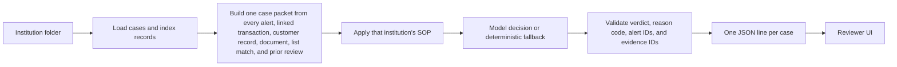

# Casework — Track 1 transaction-monitoring review

Casework turns a transaction-monitoring case into one evidence-backed disposition. It reviews all alerts on a case together and returns `CLOSE`, `RFI`, or `ESCALATE` with the policy reason code and source IDs.

## Run the decision system

Python 3.9+ and the standard library are sufficient. No package installation is required.

From the `hackathon/system/` directory:

```sh
./run institutions/bank output/bank.jsonl
./run institutions/emoney output/emoney.jsonl
./run institutions/investment output/investment.jsonl
./run institutions/payments_fx output/payments_fx.jsonl
```

The executable also accepts absolute paths and works when invoked from another directory. It writes exactly one JSON line per input case. `stdout` is left for output; progress and warnings go to `stderr`.

With `OPENROUTER_API_KEY` set, the system uses the OpenRouter Chat Completions API and defaults to `openai/gpt-6.1-sol`. Set `OPENROUTER_MODEL` to use another permitted model. The key is read from the environment and is never written to disk. API requests use temperature 0, a fixed seed, and a stable per-case session ID to make repeated runs more consistent. To set routing-price overrides for cost logging, use `OPENROUTER_INPUT_USD_PER_MILLION` and `OPENROUTER_OUTPUT_USD_PER_MILLION`.

Without a key, or with `TM_OFFLINE=1`, the system uses its deterministic local fallback. The fallback also takes over after three consecutive provider failures. API mode uses temperature 0, a fixed seed, constrained JSON output, exact institution policy text, and local checks on the decision code and evidence IDs.

## Decision flow



The case packet includes every alert, alert-linked transactions, a bounded sample of other review-window transactions, customer declarations, selected documents, matching internal-list entries, and recent prior-review notes. Prior reviews are context only; they do not explain new activity by themselves. Evidence text is treated as data, never as instructions.

The model must explain why the full case can be closed, identify one specific RFI request when there is no suspicion, or escalate when suspicion exists. The output validator restores the exact alert list from the input case, rejects evidence IDs that were not supplied for that case, limits the evidence list to eight items, and repairs invalid reason codes to a permitted code for that verdict. The fallback uses conservative evidence-matching, fraud/mule/structuring signals, internal-list checks, and rule-specific RFI requests.

## Reviewer interface

Start the read-only local interface from `hackathon/` after generating output files:

```sh
python3 system/ui_server.py
```

Open `http://127.0.0.1:8765`. The interface switches between all four institutions, searches and filters the worklist, groups alerts by case, shows the transaction timeline and source documents, and highlights the IDs used in the disposition. For Payments & FX, it makes the held-payment consequence visible. Source documents can be expanded in place. No decision is written back from the UI.

## Stress tests and output checks

From `hackathon/`:

```sh
PYTHONPATH=system python3 -m unittest discover -s system/tests -v
PYTHONPATH=system python3 system/validate_outputs.py
```

The synthetic stress suite covers fraud reports overriding benign-looking invoices, admitted pass-through/mule activity, structuring indicators, name-only versus identifier-confirmed internal-list matches, benign context that must not trigger escalation by itself, amount and beneficiary mismatches, partial invoice coverage across multiple payments, one explained alert alongside an unexplained alert, stale prior reviews, held-payment inclusion, fluent source citations, output-code repair, citation allowlisting, and malformed model JSON.

`validate_outputs.py` checks all 4,000 development rows for missing or duplicate cases, exact alert coverage, legal verdict/reason-code pairs, 2–4 sentence reasons, actionable RFI wording, duplicate evidence IDs, and evidence IDs that belong to the case's data.

## Performance and cost

Offline mode completed a 1,000-case bank run in 1.8 seconds in an isolated timed run here, with no API cost. For model mode, the development case-packet size measured roughly 3,900–8,100 input-token estimates per case (character count divided by four; actual tokenization varies). At OpenRouter's current default-routing GPT-6.1 Sol rate of $2/M input and $10/M output tokens, a 200-case run is estimated at about $2.6 on median-sized packets and about $3.5 using the 95th-percentile input size plus the full 320-token completion cap. The measured median provider latency is about 4.4 seconds before local overhead, or roughly 15 minutes for 200 sequential cases. Runtime logs report actual token usage and an estimated cost when OpenRouter returns usage data. Pricing and provider latency can change.

This environment did not have an OpenRouter key, so the included development outputs were generated in offline mode. The API request path is implemented but was not exercised against a live provider here. Run the system with your authorized key to regenerate development outputs in model mode before submission if desired.

## Current output files

The output directory contains system-generated predictions for the 1,000 development cases from each institution. The unseen set is not present in this workspace and is never read by the system.
